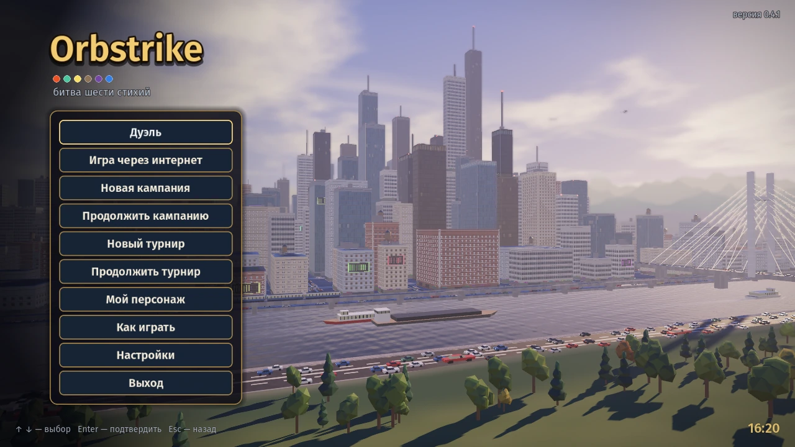
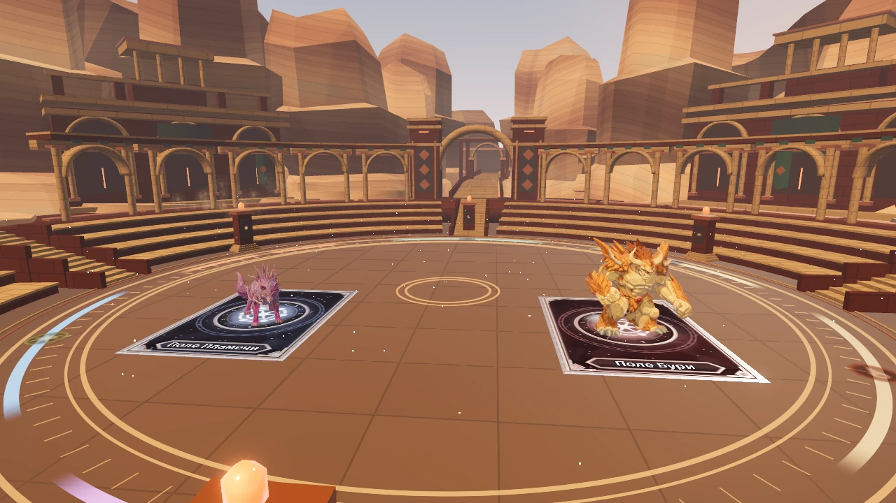
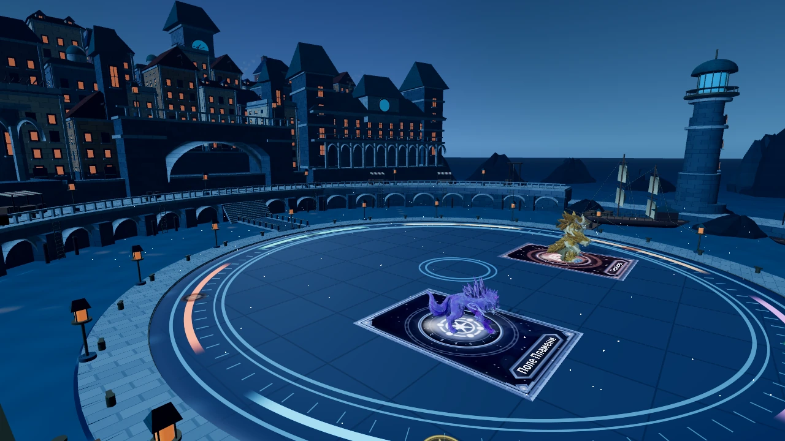

# Orbstrike

**Битва шести стихий**

Пошаговая 3D-дуэль: собирайте команду существ, бросайте сферы на карты ворот
и меняйте исход боя способностями.

**[⬇ Скачать для Windows · 0.4.6](https://github.com/TheProshkaPro25/Orbstrike/releases/download/v0.4.6/Orbstrike_v0.4.6_win64.zip)**

[Что нового](https://github.com/TheProshkaPro25/Orbstrike/releases/tag/v0.4.6) · [Как играть](docs/RULES.md) · [Сообщить об ошибке](https://github.com/TheProshkaPro25/Orbstrike/issues)

## Соберите свою команду

- **67 вариантов существ, 6 стихий.** Выберите трёх бойцов и колоду под свой стиль.
- **Карты, ловушки и контратаки.** Открывайте ворота в нужный момент и отвечайте на способности соперника.
- **Физические броски.** Сфера летит, отскакивает и катится — место остановки влияет на игру.
- **Дуэль с ИИ, турнир и кампания.** Три кубка, семь постоянных соперников и четыре арены.
- **Свой персонаж.** Настройте внешность героя, который выходит на арену вместе с командой.

*Янтарный каньон — одна из четырёх арен.*

*Лунная гавань. В дуэли также доступны Святилище стихий и Каменная бухта.*

## Начать играть

1. Скачайте Windows ZIP по ссылке выше и распакуйте его целиком.
2. Запустите `Orbstrike.exe`, оставив остальные файлы рядом.
3. Выберите «Дуэль» или «Новая кампания». Подсказки доступны в «Как играть».

Выбирайте карты, существ и подсвеченные цели мышью. В локальном матче
«Следующий ход» нажимается мышью или `Enter`. `Enter` также подтверждает
итог боя, а `Esc` или правая кнопка отменяют выбор. Цель — выбить трёх существ соперника.

**В клиенте 0.4.6** появилась Каменная бухта и открылась Комната анимаций.
Обновлены Ратник во всех шести стихиях, Горгул Тени, 49 портретов и
интерфейс матча. Тени и масштаб отрисовки 3D можно настроить отдельно.
Сохранения используют прежний каталог.

Доступны одиночные режимы. Для интернет-дуэли нужен сервер с правилами 11.
Публичный сервер 0.4.0 работает с правилами 10 и несовместим с этим клиентом.

---

Ранее игра называлась «Сферы Стихий». Старые сохранения продолжают работать.
[Разработка и запуск из исходников](docs/DEVELOPMENT.md) · [Как устроен проект](docs/PROJECT_JOURNAL.md) · [История изменений](CHANGELOG.md) · [Авторы и лицензии](CREDITS.md)
