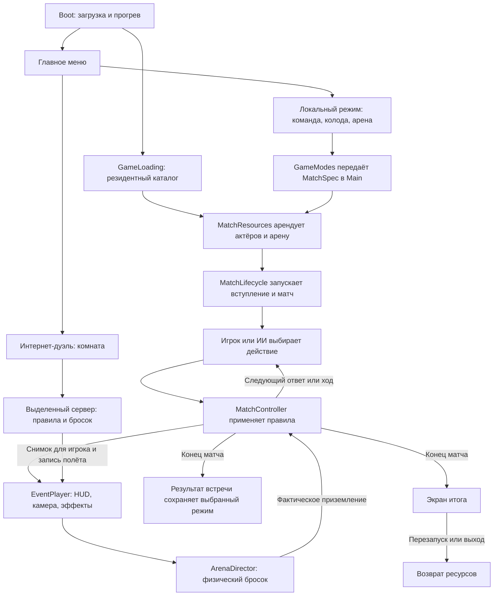

# Orbstrike — журнал устройства проекта

Срез клиентских исходников на 12 ноября 2026 года. Orbstrike, прежде «Сферы
Стихий», — пошаговая 3D-дуэль на Godot 4.7.2 и GDScript. Игрок собирает
команду из трёх существ одной стихии, кладёт карты ворот, бросает сферы на поле
и разыгрывает способности в ответ на действия соперника. Карты и решения
определяют правила боя. Физика определяет, на какие ворота в действительности
попала сфера.

Журнал связывает путь игрока с исходниками. Точный текст эффектов и управление
собраны в правилах. Состояние выпуска проверяется по записи о выпуске и его
контрольному отчёту. [Правила игры](RULES.md) · [Запуск из исходников](DEVELOPMENT.md)
· [Текущее состояние](../NEXT_SESSION.md) · [История выпусков](../CHANGELOG.md)

## 1. От запуска до результата

Главное меню содержит дуэль с ИИ, турнир, кампанию, карьеру, редактор «Мой
персонаж», настройки, справку и интернет-дуэль. В дуэли можно выбрать арену,
сложность, состав и стартовую колоду. Перед первым ходом камера показывает
локацию и бойцов. В матче поле, руки и кнопки ведут через текущую фазу.
Итог боя объясняет силу и исход. С экрана завершённой встречи можно
вернуться к настройке дуэли или к табло режима. [Главное меню](../scenes/menu/main_menu.gd)
· [Вход в матч](../scenes/main.gd) · [Экран результата](../scenes/ui/game_over.gd)

| Кто отвечает | Что ему принадлежит |
| --- | --- |
| [Main](../scenes/main.gd) | Собирает мир, интерфейс и зависимости, соединяет сигналы локального матча. |
| [GameModes](../scenes/modes/game_modes.gd) | Вход и выход, регистрация, очередная встреча, сохранение результата. Передаёт состав, арену, исходное число генератора случайности (seed), первый ход и параметры ИИ через [MatchSpec](../scenes/modes/match_spec.gd). |
| [MatchLifecycle](../scenes/match_lifecycle.gd) | Переходы от выбора и подготовки через вступление к игре, завершению, ошибке или освобождению. Разрешает ввод в игровом состоянии. |
| [MatchResources](../scenes/match_resources.gd) | Аренда арены и актёров, скрытый резерв и активные экземпляры, возврат и откат при неполной подготовке. |
| [InteractionController](../scenes/interaction/interaction_controller.gd) | Выбранная карта, существо, ворота или цель способности, отмена, подтверждение и ожидание постановки. [InteractionView](../scenes/interaction/interaction_view.gd) связывает этот выбор с кнопками, клавиатурой и полем. |
| [MatchController](../core/match_controller.gd) | Состояние правил, допустимые команды и цели, причины запретов, порядок ответов и результат. |
| [MatchPresentation](../scenes/presentation/match_presentation.gd) | Видимые события, актуальные руки, портреты, подсказки, журнал, разбор боя и эффекты. |
| [ArenaDirector](../scenes/presentation/arena_director.gd) | Постановка карты, полёт сферы, раскрытие, размещение фигур и контакт во время атаки. [EventPlayer](../scenes/event_player.gd) последовательно ждёт завершения каждого показа. |

## 2. Каталог, правила и расчёт силы

### Из чего состоит колода

Таблицы `GameData` задают названия, базовую силу, стихии, параметры карт и
готовые колоды. `CardDB` превращает их в определения `CreatureDef`, `CardDef`
и `DeckDef`, строит список доступных карт и валидирует подбор. В поле у
каждого существа свой числовой `uid` на матч. Одно и то же определение
существа может использоваться обеими сторонами.

- Восемь семейств — Драгнар, Клыкарь, Грифалон, Колоссар, Рогожук, Левиан,
  Ратник и Горгул. Каждое представлено в Пламени, Буре, Свете, Камне, Тени
  и Приливе. Всего 48 обычных вариантов. Ликорез Тени — 49-й вариант и
  редкая встреча в подборе соперника обычной дуэли.
- В обычной колоде три разных существа одной стихии с суммой базовой силы
  до 1100, по одним золотым, серебряным и бронзовым воротам и по одной
  красной, синей и зелёной способности. Карты с требованием к стихии или
  семейству должны подходить команде. В карьере поверх этих условий
  проверяются коллекция, уровни и лимит лиги.
- Золотые ворота ориентированы на стихии, серебряные — на вид существа,
  бронзовые содержат особые правила, в том числе ловушки. Красные способности
  привязаны к стихии, синие дают числовые усиления, зелёные привязаны к виду.
  Конкретные условия, моменты применения и исключения записаны в параметрах
  и тексте карты.

[Таблицы GameData](../data/game_data.gd) · [Каталог и проверка колоды](../core/card_db.gd)
· [Определение карты](../core/card_def.gd) · [Общие признаки эффектов](../core/card_effects.gd)

### Что происходит на ходу

1. В начале три существа, три карты ворот и три способности. Со второго
   личного хода игрок добирает карту из подходящего команде запаса.
2. При подготовке можно выложить ворота на доступное место поля из шести
   позиций. На пустом поле выкладка обязательна. «Ворота + бросок» совмещает
   выкладку и запуск выбранного существа.
3. Игрок выбирает существо и цель. Пустые ворота занимаются, встреча с
   противником начинает бой, встреча с союзником ведёт к перемещению или
   захвату. Остановка вне ворот засчитывается как промах. Использованных
   живых существ возвращают в руку, когда иначе бросать некого.
4. В основном режиме `ANIME_INSPIRED` владелец открывает ворота только в свой
   ответ в бою. До открытия вклад ворот в G равен нулю, ловушки ждут открытия.
   Способности можно прикрепить в разрешённый момент до броска или после
   свободного приземления. В бою стороны отвечают по очереди. Лимит — три
   способности с каждой стороны с учётом прикреплений и отменённых карт.
   Два последовательных паса завершают обмен.
5. В обычном бою сравниваются итоговые G, при равенстве побеждает защитник.
   Победитель забирает ворота, уходит в использованные и получает ход,
   проигравший выбывает. Особые карты могут спасти проигравшего, оставить
   победителя на поле, прервать бой, убрать обоих или передать ход другой
   стороне. Потраченные способности обычно отдыхают два следующих боя.
6. Матч заканчивается после выбытия всех трёх существ одной стороны.
   При 60 ходах сравниваются число живых существ, затем их базовая сила.
   Возможна ничья. Два пропуска подряд при занятых воротах приводят к
   вынужденному бою с отдельным жребием атакующей стороны.

[Правила и исключения](RULES.md) · [Фазы и команды матча](../core/match_controller.gd)
· [Основной режим и исторический LEGACY](../core/match_rules.gd)

### Как считается результат

`MatchState` хранит участников, шесть мест поля, живых и выбывших существ,
их статус, руки и текущий бой. `MatchController` принимает команды и
изменяет это состояние. `duplicate_view` строит снимок от лица участника
с маскировкой чужой руки и закрытых ворот. Это же представление получает ИИ.
Предпросмотр возможного ответа считает результат на копии.

`PowerCalc` начинает с базовой силы, учитывает действующие ворота и метки,
проводит прикрепления и разыгранные способности в нужном порядке. Он
разбирает отмену, подавление, слияния, копирование и позицию эффекта в
цепочке. Пороговые правила, фиксация силы и «Зеркало» могут изменить итог.
«Трон сумрака», «Общая бездна» и «Отлив» способны поменять сам тип исхода.
Результат содержит разбивку G и данные об эффектах. Контроллер использует
их при изменении поля, интерфейс — при показе, ИИ — при сравнении вариантов.
Логика в `core/` работает с данными и сигналами, без сцены, рендера и ожидания
анимаций. [Снимок состояния](../core/match_state.gd) · [Расчёт силы](../core/power_calc.gd)
· [Данные результата](../core/battle_result.gd)

### Как выбирает ИИ

`AIPlayer` получает снимок своей стороны и разрешённые действия из
контроллера. Он выбирает выкладку, существо, ворота, прикрепление, открытие,
способность, цель или пас. «Новичок» принимает менее точные решения и
бросает с большим разбросом. «Боец» сравнивает перевес, запас на ответ и
стоимость способности. «Мастер» оценивает вероятные ловушки и ответы по
публичным сведениям и рассматривает пары карт. Разброс применяется к цели
до физического броска. Именные NPC используют те же правила и меняют
веса оценки, например склонность к атаке и цену расхода карты.
[ИИ и уровни сложности](../core/ai_player.gd) · [Локальный ввод и передача решения](../scenes/interaction/interaction_controller.gd)

## 3. Локальные режимы

| Режим | Как проходит | Где смотреть |
| --- | --- | --- |
| Дуэль | Одна встреча с ИИ. Игрок задаёт колоду, арену и сложность. Противник подбирается из каталога. После результата доступен новый матч. | [GameModes](../scenes/modes/game_modes.gd) · [Команда и колода](../scenes/ui/team_menu.gd) |
| Турнир | Игрок и семь постоянных NPC играют в двух группах по четыре. Победа приносит 3 очка, ничья — 1. Два лучших из группы выходят в полуфиналы, затем в финал. Группа, полуфинал и финал используют Каньон, Гавань и Святилище. | [Турнирная сетка](../core/tournament.gd) · [Табло](../scenes/ui/tournament_panel.gd) |
| Кампания | Последовательно открываются кубки Каньона, Гавани и Стихий. Колода и сложность закрепляются при регистрации. Следующий кубок открывается по завершении текущего. Публичные факты трёх последних законченных личных встреч слегка меняют предпочтения NPC к следующей встрече. | [Кампания](../core/campaign.gd) · [Правила кампании](RULES.md#кампания-без-сюжета-и-постоянные-соперники) |
| Карьера | Отдельная коллекция с опытом, кредитами, магазином, командой и колодой. Лиги ограничивают боевые уровни, силу одного участника и всей команды. Зарегистрированные состав, карты и уровни закрепляются до конца кубка. Зачтённая встреча выдаёт награду один раз. | [Карьера](../core/career.gd) · [Меню карьеры](../scenes/ui/career_panel.gd) |

Матчи игрока используют физический полёт. Фоновые встречи двух NPC
симулируются с тем же контроллером, ИИ и расчётом G, но с попаданием точно
в выбранные ворота. Это даёт воспроизводимое табло из сохранённых seed и
колод. При выходе посреди встречи турнир, кампания и карьера повторяют
встречу с её начального состояния. [Симулятор NPC](../core/tournament_npc_simulator.gd)
· [Сохранение турнира](../data/tournament_session.gd)

## 4. Загрузка и жизненный цикл матча

Точка входа указана в `project.godot` и ведёт в `boot.tscn`. Boot показывает
прогресс. `StartupCatalog` загружает ресурсы и проверяет обязательные
зависимости. `GameLoading` держит резидентный каталог после открытия
главного меню. Под экраном загрузки создаются 98 сфер
(по два экземпляра 49 вариантов), три арены, четыре человеческих актёра
(по два на каждую VRM-основу) и интерфейс. Портреты существ, звук и эффекты
прогреваются до меню. Скрытый
`SubViewport` и игровой viewport используются для прогрева материалов и
освещения. Обязательная ошибка подготовки остаётся видимой на Boot.

`MatchResources` берёт шесть существ по их определениям. Неактивные
экземпляры скрыты, отключены от обработки и ждут в `_prepared_balls`.
При броске конкретный экземпляр с нужным `uid` переходит в активные.
При уходе со сцены вывод из игры отделён от возврата экземпляра после
показа. Идентификатор аренды защищает новое использование от запоздалого
завершения предыдущего. При перезапуске и выходе ресурсы очищаются и
возвращаются в каталог. Штатный запуск использует уже подготовленные
экземпляры. Изолированные стенды без Boot могут сами подготовить шесть
акторов в отдельном пути. [Настройки проекта](../project.godot) · [Boot](../scenes/loading/boot.gd)
· [Список загрузки](../scenes/loading/startup_catalog.gd) · [Резидентный каталог](../scenes/loading/game_loading.gd)
· [Аренда ресурсов](../scenes/match_resources.gd) · [Переходы матча](../scenes/match_lifecycle.gd)

## 5. От выбора ворот до раскрытия существа

1. Интерфейс передаёт разрешённые ворота в `ArenaDirector`. Для ИИ
   учитывается разброс. Человеческий актёр показывает замах и выпускает
   сферу из руки.
2. `ShotPhysics` рассчитывает начальную скорость. Затем `CreatureBall`
   летит, отскакивает и катится с затуханием как `RigidBody3D`. Камера
   следует за телом, звук отмечает касания. Выбор ворот задаёт цель,
   отдельного жеста оттягивания мыши в обычном матче нет.
3. Сигнал `settled` передаёт фактическую точку остановки. `Arena.slot_at`
   находит место по этой точке и контроллер получает номер места или
   промах. Сфера остаётся в точке остановки при переходе к раскрытию.
4. `hold_landing_pose()` фиксирует мировое положение и поворот оболочки.
   Фигура раскрывается вертикально.
   Дальнейшее размещение и перемещения следуют из событий правил.

У карты ворот своя постановка. Она летит в маленьком масштабе, и только
после контакта с полом идут рост и стихийная волна. При обмене камера
показывает участников, эффект карты и контакт. Очередь событий завершает
показ перед следующим разрешённым действием. [Начальная траектория](../scenes/shot_physics.gd)
· [Физическая сфера](../scenes/creature_ball.gd) · [Постановка](../scenes/presentation/arena_director.gd)
· [Поле и привязка позиции](../scenes/arena.gd) · [Очередь событий](../scenes/event_player.gd)

## 6. Существа, анимации и ткань

- `CreatureModels` связывает вид и стихию с импортированной HD-моделью,
  подготавливает масштаб, материалы и границы кадрирования. Резервные
  модели в `assets/creatures/` дают запасной визуальный путь для
  соответствующего архетипа. `CreatureBall` объединяет оболочку,
  коллизию, фигуру, анимацию, ткань и эффекты.
  [Модели](../scenes/creature_models.gd) · [Оболочка](../scenes/fx/ball_shell.gd)
- `CreatureAnim` подбирает позы, клипы и процедурные движения для
  появления, ожидания, атаки и реакции. У Грифалона и Колоссара есть
  отдельные авторские наборы движений. Ратники используют постановку
  мечевого удара. У части видов дополнительные скрипты отвечают за
  крылья, хвост, стойку или попадание. [Анимация существ](../scenes/creature_anim.gd)
  · [Грифалон](../assets/animations/grifalon/README.md)
  · [Колоссар](../assets/animations/kolossar/README.md) · [Мечевой удар](../scenes/humanoid_strike.gd)
- `CreatureSupport` рассчитывает опорные точки и положение тела над
  воротами по данным модели и позы. Кэш опор хранит расчётные данные
  без узлов сцены и ограничен 64 записями в резидентном режиме.
  `PreparationStore` читает заранее подготовленные производные данные
  из `assets/prepared/`. При недоступном ключе или файле расчёт
  выполняется заново. [Опора](../scenes/creature_support.gd)
  · [Формат кэша](../scenes/loading/preparation_store.gd) · [Манифест](../assets/prepared/manifest.json)
- `CreatureCloth` связывает выделенное полотно плаща Ратника с
  GPU-солвером и коллайдерами. Резидентный солвер сохраняет GPU-подготовку при переносе
  экземпляра между сценами, разделяет неизменяемые буферы и держит
  изменяемое состояние отдельно. При отсутствии compute-устройства
  сохраняется скелетный вариант. Изменения геометрии проходят отдельный
  конвейер с контролем скелета, rest pose, bind, UV и уже принятых
  ремонтов 030–035. [Ткань](../scenes/creature_cloth.gd)
  · [Резидентный солвер](../scenes/resident_cloth_solver.gd)
  · [Локальные изменения аддона](../addons/godot_gpu_cloth/LOCAL_CHANGES.md)
  · [Конвейер моделей](../tools/models/README.md)

## 7. Арены, камера, эффекты и звук

**Арены.** Святилище стихий — закрытый зал с витражами. Янтарный каньон —
амфитеатр в ущелье. Лунная гавань — ночная бухта с набережной и судами.
Локации имеют общую сетку ворот и отличаются окружением, светом и
постановкой вступления. Выбранная арена сохраняется. Главное меню имеет
собственную панораму города с небом, сменой времени суток, движением транспорта
и стихийными сферами. [Локации](../data/arena_locations.gd)
· [Вступление](../scenes/presentation/location_intro.gd)
· [Каньон](../scenes/canyon_landscape.gd) · [Гавань](../scenes/harbor_landscape.gd)
· [Панорама меню](../scenes/menu/menu_city.gd) · [Смена времени суток](../scenes/menu/day_cycle.gd)

**Камера.** `CameraRig` переключается между общим планом, погоней за
сферой, облётом раскрытия и позициями для броска карты, обоих существ,
способности, удара и победителя. Для крупных фигур камера учитывает
границы модели. `BattleTempo` меняет темп постановки от ×0,75 до ×2.
На чтение подсказок отводятся реальные секунды, решения в локальном
матче можно обдумывать без таймера. [Камера](../scenes/camera_rig.gd)
· [Темп](../scenes/presentation/battle_tempo.gd)

**Эффекты в матче.** Boot прогревает шесть собственных шлейфов Orbstrike,
по одному на стихию. Шлейф записывает путь центра оболочки в физическом
цикле. В шейдере голова привязана к текущему центру, остальная лента
остаётся вдоль пройденного пути. При качении история очищается, после
остановки или выхода эффект возвращается в пул. В изолированной сцене
без Boot доступны резервная лента и частицы Kenney. Также в матче работают
лучи витражей, искра контакта, дуга меча Ратника, вспышка Пламени и мерцание
захваченных ворот. [Пул шлейфов](../scenes/fx/flight_trails.gd)
· [Шейдер и стили](../assets/vfx/trails/README.md)
· [Эффекты матча](../scenes/presentation/match_effects.gd)
· [Свет витражей](../scenes/sanctuary_window_light.gd)
· [Места подключения пакетов](../tools/vfx_showcase/README.md#пакеты-и-точки-подключения)

**Визуальные стенды.** В сравнительном стенде доступны ещё четыре
процедурных стиля и локальные образцы Vefects. Мягкая светотень, пробы
материала плаща Ратника и свет Святилища по мотивам Persona 3 Reload
зафиксированы как отдельные эксперименты. Обычный матч использует
материалы существ и MToon аватаров из текущих игровых сцен.
[Стенд VFX](../tools/vfx_showcase/README.md)
· [Мягкая светотень](../NEXT_SESSION.md#доработка-мягкой-светотени--12-ноября-2026)
· [Свет Святилища и плащ](../NEXT_SESSION.md#плащ-ратника-и-проба-света-святилища--12-ноября-2026)

**Звук.** `SoundFx` загружает каталог, использует пул проигрывателей для
бросков, ударов, стихий и голосов существ, чередует варианты частых событий.
Музыкальные темы меню, подготовки команды и боя переходят с плавным
смешением, в столкновении используется отдельная тема. Настройки музыки,
эффектов и интерфейса независимы. [Звуковая система](../scenes/audio/sound.gd)
· [Громкость и сохранение](../scenes/menu/audio_settings.gd) · [Происхождение звуков](../CREDITS.md#звуковые-эффекты)

## 8. Герой, гардероб и сохранения

«Мой персонаж» использует две VRM-основы — Сакурада и Вита. Редактор
меняет имя, рост, причёску, детали лица, кожу, глаза, костюм, отдельные
джинсы и футляр в доступных сочетаниях. В полной локальной галерее 25
костюмов, 12 у Сакурады и 13 у Виты. Номера в сохранениях стабильны.
При смене основы пять общих фасонов переходят на соответствующий вариант.
при недоступном фасоне выбирается базовый. Ушедшие варианты Сакурады
№ 10 и № 11 читаются с возвратом к стандартному костюму.
[Редактор персонажа](../scenes/ui/character_editor.gd)
· [Номера, фасоны и совместимость](../data/wardrobe_catalog.gd)
· [Нормализация профиля](../data/player_profile.gd)

Готовая палитра или свой RGB/HEX-цвет меняют материал костюма с сохранением
светлоты текстуры, складок и альфы. Настройки джинсов, футляра и исходного
цвета имеют отдельные поля. `VrmAvatar` и `VrmParts` собирают внешний вид
из общих сеток и текстур с локальными материалами. `VrmFighter` использует
тот же профиль в матче, показывает броски сферы и карты, жест способности
и реакции. `FighterPortrait` рендерит отдельную модель в спокойной позе.
Модель разделяет ресурсы с актёром матча, а портрет с неподвижными
материалами обновляется по запросу. Именные NPC получают заранее заданные совместимые
образы. [Сборка аватара](../scenes/avatar/vrm_avatar.gd)
· [Части и материалы](../scenes/avatar/vrm_parts.gd)
· [Шейдеры палитр](../scenes/avatar/mtoon_palette/README.md)
· [Актёр на арене](../scenes/avatar/vrm_fighter.gd)
· [Портрет героя](../scenes/avatar/fighter_portrait.gd)

| Путь в `user://` | Что хранится |
| --- | --- |
| `settings.cfg` | Графика, лимит FPS, звук, стиль интерфейса, уменьшение движения, темп и выбранная арена. |
| `player_profile.json` | Имя и внешность героя, нормализуемые при чтении, текущая версия формата 2. |
| `tournament/active.json` | Зарегистрированный состав, жеребьёвка, встречи, результаты и история турниров. |
| `campaign/active.json` | Кубки кампании, зарегистрированный состав, результаты и память соперников. |
| `career/active.json` | Коллекция, уровни, кредиты, регистрация, встречи и события наград. |
| `online.cfg` | Адрес сервера для интернет-дуэли. |
| `replays/last_match.json`, `replays/last_error.json` | Диагностические трассы законченного матча или отклонённой команды. Записывают seed, команды и приземления для технического повтора правил. |

Старое имя каталога `Godot/app_userdata/Сферы Стихий` сохранено в
настройках проекта для Windows и macOS, для Linux настроен вариант
`godot/app_userdata/Сферы Стихий`. Турнирные режимы сохраняют регистрационные
данные и принятые результаты встреч атомарно. Возобновление ведёт к табло
и началу встречи с сохранёнными параметрами. Реплей воспроизводит команды
правил с записанным попаданием. [Настройки каталога](../project.godot)
· [Повтор команд](../core/match_replay.gd) · [Инструмент повтора](../tools/replay.gd)

## 9. Интерфейс и доступность

- **Подготовка.** `TeamMenu` фильтрует состав и карты по стихии и виду,
  показывает ограничение G и текущий выбор. `ArenaPicker` меняет живой
  предпросмотр места. `CreaturePreview` показывает модель или карту.
  Активность скрытых предпросмотров ограничена, чтобы они не рисовали
  каждый кадр под открытым окном. [Команда](../scenes/ui/team_menu.gd)
  · [Выбор арены](../scenes/ui/arena_picker.gd) · [Предпросмотр](../scenes/ui/creature_preview.gd)
  · [Активность предпросмотров](../scenes/ui/preview_activity.gd)
- **Ход и бой.** `Hud` показывает состояние матча и следующее действие,
  `SetupPanel` и `AbilityPanel` — доступные руки. `BattleHud` показывает
  обоих существ, силу и её изменения, расход способностей и цепочку
  карт. Портреты существ используют подготовленные 2D-силуэты со
  стихийным фоном. Информация о результате собирается из того же
  расчёта G, что применён в бою. [HUD](../scenes/ui/hud.gd) · [Боевой HUD](../scenes/ui/battle_hud.gd)
  · [Рука ворот](../scenes/ui/setup_panel.gd) · [Рука способностей](../scenes/ui/ability_panel.gd)
  · [Портреты существ](../scenes/ui/creature_portrait.gd)
- **Карточная справка.** Наведение и клавиатурный фокус показывают
  эффект, ограничения и причины недоступности. Открытая подсказка
  привязана к карточке и состоянию фазы. При изменении фазы, отмене
  выбора или закрытии панели восстанавливается подходящий фокус.
  Чужое закрытое содержимое берётся только из разрешённого снимка стороны.
  [Отображение карты](../scenes/ui/card_view.gd) · [Раскрытие и закрытие подсказок](../scenes/ui/card_hover.gd)
- **Управление.** Мышь и клавиатура доступны для основных действий.
  `Tab` и стрелки переводят фокус, `Enter` подтверждает, `Esc` или
  правая кнопка отменяют текущий выбор. У выбора цели способности и
  выбора ворот есть клавиатурные списки. Условия длинной карты
  прокручиваются. Иконки стихий и подписи дополняют цветовые признаки.
  Русские игровые тексты в основном находятся в таблицах данных,
  интерфейсе и текстах причин.
  [Выбор цели способности](../scenes/ui/ability_target_picker.gd)
  · [Выбор места на поле](../scenes/ui/arena_slot_picker.gd) · [Оформление UI](../scenes/ui/ui_theme.gd)
  · [Управление](RULES.md#интерфейс)
- **Настройки.** «Классический» и «Наручный прибор» меняют оформление.
  Есть настройка уменьшения движения интерфейса, три уровня графики,
  лимиты 60/90/120/144 FPS и вариант без лимита. Графический уровень
  управляет тенями, сглаживанием, детализацией и частью эффектов.
  Громкость интерфейса настраивается отдельно от музыки и эффектов.
  [Окно настроек](../scenes/menu/menu_settings.gd)
  · [Оформление и движение](../scenes/ui/device_settings.gd)
  · [Графические пресеты](../scenes/graphics_settings.gd)

## 10. Интернет-дуэль и граница сервера

Игрок вводит адрес выделенного сервера, создаёт комнату или присоединяется
по восьмизначному коду. Участники выбирают законные колоды и подтверждают
готовность. Создатель комнаты получает первый ход. После результата
реванш требует согласия обоих. При потере связи для новой встречи нужно
создать комнату заново. Для внешнего адреса клиент ожидает `wss://`. В проекте
есть поддержка loopback для разработческой среды.
[Экран комнаты и онлайн-матча](../scenes/online/online_game.gd)
· [Соединение клиента](../network/online_client.gd) · [Правила интернет-дуэли](RULES.md#приватная-интернет-дуэль)

- **Запросы.** Клиент посылает команду, например поставить ворота, выбрать
  существо, бросить в выбранное место, открыть ворота, сыграть или
  пропустить. Сервер проверяет принадлежность команды подключению,
  фазу и допустимость действий. Правила, итог и физическое приземление
  определяются на сервере.
- **Ответы.** Сервер передаёт каждому игроку его снимок с разрешёнными
  действиями, публичными событиями и данными боя. Закрытые чужие карты
  маскируются. Для броска передаётся общая запись позиций и вращения.
  Клиент показывает её через те же компоненты постановки и применяет
  снимки в нужном порядке.
- **Совместимость.** При соединении проверяются версия JSON-протокола
  и отпечаток каталога и правил. Текущий клиентский код использует
  `online-rules-11`. Опубликованный серверный пакет 0.4.0 использует
  `online-rules-10`. Для этой комбинации интернет-дуэль несовместима.
  Размещение сервера и дальнейший выпуск сервера вынесены в отдельную
  документацию проекта.

[Формат и отпечаток протокола](../network/online_protocol.gd)
· [Кодирование снимка](../network/state_codec.gd) · [Адаптер снимка](../network/online_view.gd)
· [Видимость подсказок](../scenes/presentation/online_help_policy.gd)
· [Справка по серверу](ONLINE_SERVER.md)

## 11. Карта проекта и происхождение ресурсов

| Где | Что искать |
| --- | --- |
| [core/](../core/) и [data/](../data/) | Правила, определения и состояния, карточные таблицы, ИИ, турнирные режимы, форматы профиля и таблица локаций. |
| [scenes/](../scenes/) | Игровые сцены и код загрузки, актёров, поля, ввода, HUD, постановки, меню, звука и онлайн-экрана. |
| [network/](../network/) | Клиент, протокол, кодирование снимков и исходники выделенного сервера. |
| [assets/creatures_hd/](../assets/creatures_hd/) и [assets/animations/](../assets/animations/) | Импортируемые модели, текстуры и авторские библиотеки анимаций. |
| [assets/cards/](../assets/cards/) и [assets/portraits/](../assets/portraits/) | Иллюстрации карт и подготовленные изображения существ для UI. |
| [assets/avatars/](../assets/avatars/) и [addons/](../addons/) | VRM-основы и подготовленные детали одежды и движений, импорт VRM, MToon и GPU-ткань. |
| [assets/audio/](../assets/audio/), [assets/fonts/](../assets/fonts/) и [assets/vfx/](../assets/vfx/) | Рабочие звуки и музыка, шрифты и собственные эффекты. Сторонние VFX имеют отдельный каталог с лицензиями. |
| [tests/](../tests/) и [tools/](../tools/) | Регрессии, узкие стенды, симуляторы, отчёты и подготовка моделей, одежды и аудио. |
| [docs/](./) | Правила, инструкции, аудиты и архив. Сборки, логи и кадры стендов пишутся в локальный `build/`. |

В `CREDITS.md` перечислены авторы, источники и лицензии VRM-основ pixiv,
MToon, подготовленных частей из itch.io и BOOTH, набора движений
Quaternius, GPU-ткани, Fira Sans, музыки и звуковых эффектов. Скрипты
подготовки, исходные архивы и
результирующие игровые ресурсы могут иметь разные условия использования.
Для 0.4.3 из 25 локальных костюмов 21 входит в публичные исходники и
24 — в Windows-клиент. Три костюма доступны только внутри собранного
клиента по условиям авторов. Дирндль остаётся в локальной разработке.
Состав дистрибутива сверяется с контрольным отчётом конкретного выпуска.
[CREDITS](../CREDITS.md) · [VRM-основы](../assets/avatars/vrm/README.md)
· [BOOTH и источники комплектов](../assets/avatars/booth/README.md)
· [Подготовка аватаров](../tools/avatars/README.md)
· [Манифест сторонних VFX](../assets/vfx_vendor/sources.json)

В игровом пресете используются собственные шлейфы Orbstrike, а среди
сторонних эффектов — Effects Lab, REEBOO, Elemental Impact Lite и Kenney
с соответствующими лицензиями. Vefects хранится локально по условиям
пакета, используется для сравнения и исключён из стандартного пресета.
[Лицензии эффектов](../CREDITS.md#визуальные-эффекты-игры-и-стенда)
· [Фильтры экспорта](../export_presets.cfg)

## 12. Проверки, сборка и выпуск клиента

Воспроизводимые проверки запускает `tools/check.py`. `--list` показывает
состав, `--checks` выбирает нужные сценарии. Отчёты сохраняются в
`build/checks/<профиль>/`, выборочные прогоны — в `selected-*/`.
Графические стенды используют `tools/test_window.gd` для свёрнутого
нефокусируемого окна и отрисовки вне экрана с ограничением 60 FPS.
Лимит обычной игры хранится отдельно.
[Запуск и отчёты](../tools/check.py) · [Обёртка окна](../tools/test_window.gd)
· [Порядок проверки проекта](../AGENTS.md)

| Профиль | Что проверяет |
| --- | --- |
| `gameplay` | Правила, эффекты и крайние ситуации, ИИ, режимы и прохождение физических матчей. |
| `presentation` | Управление, HUD, подсказки, камеры, полёт, раскрытие и локации. |
| `models --visual` | Позы, анимации, опора и видимые деформации. |
| `full` | Широкая проверка по отдельному поручению о выпуске. При обычной задаче выбираются затронутые сценарии. |

`tools/sim.gd` предназначен для воспроизводимых симуляций правил и
баланса. `tools/replay.gd` повторяет диагностические команды.
Стенды моделей и одежды проверяют геометрию, импорт и позы отдельно.
Аудит архитектуры описывает проверенные границы владения ресурсами,
ввода и показа. Отчёты о моделях, физике, UI и пакете относятся к разным
типам проверки. [Симулятор](../tools/sim.gd) · [Повтор](../tools/replay.gd)
· [Конвейер моделей](../tools/models/README.md)
· [Аудит архитектуры](audits/2026-11-09-full-architecture/README.md)

В Windows-пресете Godot создаёт `Orbstrike.exe` и отдельный
`Orbstrike.pck`. При упаковке они идут вместе. Пресет исключает тесты,
стенды, исходные референсы и локальный Vefects. Номер клиента задаётся
в `project.godot` и метаданных Windows-пресета. Для выпуска отдельно
фиксируются ревизия исходников, экспорт, проверки фактического PCK,
состав ZIP, независимая проверка и факт публикации. Для публичных
файлов сверяются контрольные суммы и полная скачиваемость. Результаты
проверки PCK на Linux и запуск EXE на Windows фиксируются отдельно.
[Windows-пресет](../export_presets.cfg) · [Пример контрольного отчёта выпуска 0.4.2.6](../tools/checkpoints/release0426-validation.json)
· [История изменений и выпусков](../CHANGELOG.md)

## 13. Границы текущего устройства и очередь

- Обычная дуэль рассчитана на двух участников. Сюжет, приключенческие маршруты и другие
  форматы собраны как идеи развития. [Правила режимов](RULES.md)
  · [Рабочая очередь и идеи](../TODO.md)
- Баланс изучается на фиксированных колодах, seed и моделях решений ИИ.
  Сильные встречные сочетания стихий и карт остаются. Отчёт указывает
  выборку и условия, при которых получены цифры.
  [Методика и ограничения баланса](../tools/checkpoints/element-balance-finish-2026-11-04.md)
- Для сетевой дуэли нужен совместимый размещённый сервер. В режиме есть
  приватная комната и взаимный реванш. Рейтинга, автоматического подбора
  игроков и возобновления оборванного матча пока нет.
  [Сетевые правила](RULES.md#приватная-интернет-дуэль)
- Эксперименты со светотенью доступны в стендах. Их статус, сравнения
  и отдельные оставшиеся дефекты материалов ведутся в записи разработки.
  [Текущее состояние и стенды](../NEXT_SESSION.md)

Для разбора ошибки броска путь начинается с `ArenaDirector.launch_to`
и идёт через `CreatureBall.settled` к `MatchController.report_landing`.
Если ворота засчитаны верно, а итоговые G вызывают вопрос, дальше нужны
определение карты в `GameData`, `PowerCalc` и разбор итога в
`MatchPresentation`. Ошибки отображения рук и выбора целей можно
проследить от разрешённых действий контроллера через `InteractionController`
до панели, которая получила запрос. [Бросок](../scenes/presentation/arena_director.gd)
· [Разрешение действия](../core/match_controller.gd)
· [Представление результата](../scenes/presentation/match_presentation.gd)
